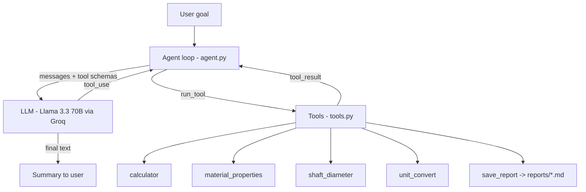

# Mech Design Agent DA-3

An agentic AI that takes a mechanical design goal (e.g. *"Size a shaft for 5 kW at 1440 rpm in EN8"*),
plans the steps, calls engineering tools, checks the results, and saves a markdown design report.

**Type:** Agentic Agent 

## Schema

### Architecture


### Agent loop (ReAct style)
1. Send goal + conversation memory + tool schemas to the LLM
2. If `stop_reason == "tool_use"` -> run each requested tool, append `tool_result`, go to 1
3. Otherwise -> return final answer (max 10 steps as a safety limit)

### Tool schemas
| Tool | Input | Output |
|---|---|---|
| `calculator` | `expression: str` | `result` |
| `material_properties` | `material: str` | yield, UTS, density, E |
| `shaft_diameter` | `power_kw, rpm, material, safety_factor=2.0` | torque, allowable shear, min + standard diameter |
| `unit_convert` | `value, from_unit, to_unit` | converted value |
| `save_report` | `filename, content` | saved path |

Full JSON schemas are in `TOOL_SCHEMAS` inside `tools.py`.

### Memory
Conversation history (`self.messages`) is kept for the whole session, so follow-up goals
("now redo it with EN24") work.

## Setup
```bash
pip install -r requirements.txt
cp .env.example .env      # add your GROQ_API_KEY
python agent.py "Size a shaft for 5 kW at 1440 rpm in EN8 with safety factor 2.5"
python agent.py           # interactive mode
```

## Example output
```
  [step 1] material_properties({'material': 'en8'}) -> {"material": "en8", "yield": 465, ...}
  [step 2] shaft_diameter({'power_kw': 5, 'rpm': 1440, 'material': 'en8', 'safety_factor': 2.5}) -> {...}
  [step 3] save_report({'filename': 'shaft_en8.md', ...}) -> {"saved": "reports/shaft_en8.md"}

Minimum diameter is ~12.2 mm, so use a 14 mm standard shaft...
```

## Limitations
Pure torsion only (no bending, keyway or fatigue). Material values are typical, not certified.
